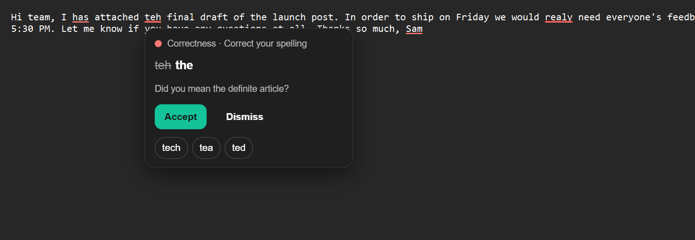
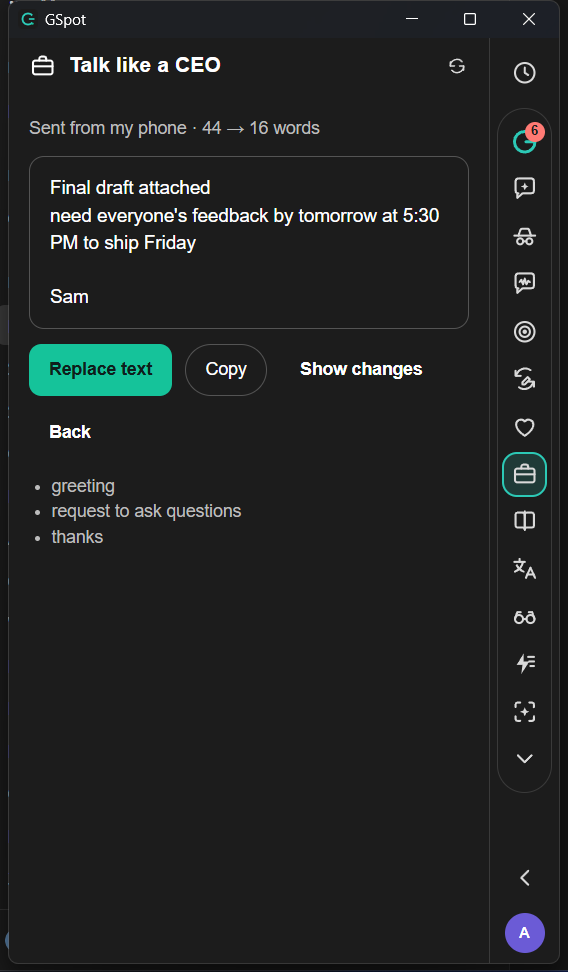
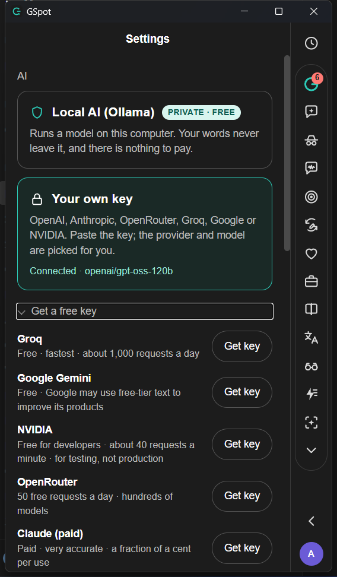

# GSpot for Windows

[](https://github.com/MAcemek/gspot/actions/workflows/ci.yml)
[](https://github.com/MAcemek/gspot/releases/latest)

A free, local-first, Grammarly-style writing assistant for **Windows**: it underlines mistakes in whatever app you are
typing in, fixes them with one click, and adds AI tools that can run entirely on your own computer.
This is a Windows port of [blueturboguy07/gspot](https://github.com/blueturboguy07/gspot) (macOS, AGPL-3.0); the original
README follows further down.



| Talk like a CEO | AI settings and free keys |
|---|---|
|  |  |

## What it does

* **Works in any app.** Reads the text field you are in through Windows UI Automation: Notepad, Word, Chrome, Edge,
  Gmail-style rich editors, forms. Hover an underline for the fix, click Accept, and it is typed straight in
  (your clipboard is never touched).
* **Offline spelling and grammar** with [Harper](https://writewithharper.com), plus smarter spelling picks (common
  words first, typo-aware: `comming` → coming, `adress` → address), stronger words for "very …", and your own
  dictionary (**Add to dictionary** on any spelling card).
* **Punctuation and grammar rules** on top of Harper: dashes (`word - word` → em dash, `10-20` → en dash), commas
  (introductory words, compound sentences, comma splices, direct address, "that"), quote punctuation, compound
  adjectives (`full-time job`), its/it's, your/you're, then/than, who/whom, pronoun case ("between you and me"),
  subject–verb agreement and tense. When you pause, an **AI grammar pass** catches run-ons and comma problems the
  rules can't safely decide, with strict guards so it never rewrites your wording.
* **Measured, not guessed**: on 270 test sentences it was never tuned on (one common error each), GSpot fixes 72% with
  the rules alone and 84% with the AI pass, up from 31% in 0.4.0. See [docs/scoreboard.md](docs/scoreboard.md) and
  [docs/scoreboard-holdout.md](docs/scoreboard-holdout.md); run it yourself with
  `cargo run --release --example scoreboard -- --holdout [--ai]` in `src-tauri/`.
* **Keyboard first**: **Ctrl+Shift+G** opens the panel from any app; put the cursor in an underlined word and press
  **Ctrl+Shift+Y** to apply the fix.
* **Writing goals and readability**: pick Formal, Friendly, Confident or Concise and the AI sentence check steers
  toward it; the Performance view rates every paragraph (Easy … Very hard, with a grade level).
* **AI tools**: rewrite, tone, translate, AI chat, Suggest options for any card, and **Talk like a CEO**, which
  cuts a message to the ask and types it the way a busy exec would (Polished, Casual, Sent from my phone)
  without touching names or numbers.
* **Your choice of AI**: Local AI through [Ollama](https://ollama.com/download) (free, private), or a free cloud key
  from Groq, Google Gemini, NVIDIA or OpenRouter (Settings → AI → Get a free key). If a cloud key hits its limit,
  GSpot falls back to your local model.
* **Starts with Windows and updates itself** from this repo's releases.

### Fast

Measured on a Windows 11 laptop (installed build):

| | Notepad | Chrome / Edge | Word |
|---|---|---|---|
| Hover card appears | 60 ms | 20–85 ms | – |
| Accept a fix | 150 ms | 40–90 ms | 320 ms |

Long documents stay fast: after you edit one paragraph of a 10,000-word document, only that paragraph is re-checked
(about 14 ms instead of about 1 s), and underlines are drawn only for the part on screen.

## Install

1. Download `GSpot_<version>_x64-setup.exe` from the [latest release](https://github.com/MAcemek/gspot/releases/latest)
   and run it. It installs for your user, no admin needed.
2. The installer is not code-signed yet. If SmartScreen says "Windows protected your PC", click
   **More info → Run anyway**. If Windows says "An Application Control policy has blocked this file",
   **Smart App Control** is on; it blocks unsigned apps, and trying again later sometimes passes.
3. Click the **G tab** on the left edge of your screen to open the panel.

For AI features, either install [Ollama](https://ollama.com/download) and run `ollama pull qwen2.5:3b`
(16 GB RAM or less) or `qwen2.5:7b`, or paste a free key under Settings → AI → Your own key.

### Known limits

* Plain editors and standard text boxes work best. **Google Docs is not supported**: it draws text on a canvas,
  and Google only gives the text with its positions to extensions it has approved. Code editors and terminals are
  skipped by default (turn GSpot on for one from the panel or Settings). Discord and Slack should behave like Chrome but are not tested yet. Use **Skip this app** where underlines
  land in the wrong place, and please [open an issue](https://github.com/MAcemek/gspot/issues).
* With a cloud key, the text you check with AI features is sent to that provider. Spelling and grammar stay on your computer.

## Build from source

```powershell
# prerequisites: Rust (rustup), Node 20+, pnpm 10, Visual Studio C++ Build Tools, WebView2 (built into Windows 11)
pnpm install
pnpm dev                                  # run with hot reload
pnpm build                                # unsigned installer in src-tauri/target/release/bundle/nsis
cd src-tauri; cargo test --lib            # Rust tests
scripts/release-windows.ps1               # signed installer + latest.json for auto-update (needs the updater key)
```

How the Windows port works: `src-tauri/src/ax_win.rs` answers the same calls as the macOS Accessibility layer
(`ax.rs`) using UI Automation, so the host loop, engine and UI are shared. Fixes select the range and type the
replacement with `SendInput`; plain fields fall back to UIA `ValuePattern`.

---

# Original macOS README


A local-first, open-source Grammarly-style writing assistant for macOS. A floating panel docked to the
left edge of the screen follows the text field you are typing in (any app), underlines issues in place,
and runs the full sidebar of tools: suggestions, AI chat, plagiarism, tone, performance score,
paraphraser, humanizer, reader reactions, translate, explain it, AI rewriter, AI detector.

The panel starts **tucked**: a small G tab sits flush with the left screen edge. Click the tab and the
panel slides out; the red close button or the "Tuck away" chevron at the bottom of the rail slides it
back. The tab shows the current suggestion count. (Grammarly tucks into the right edge; GSpot
tucks into the left. `dock_side` in Settings flips it.)

* Correctness engine: [Harper](https://writewithharper.com) (`harper-core`, in-process, offline).
  A sentence over 40 words gets a "Split the long sentence" card with a lossless split ready to accept;
  the spot check (the model) replaces it with a better split when one passes the guards.
* Text access: the macOS Accessibility API (focused field, selection, `AXBoundsForRange` geometry).
  Terminals (Terminal, iTerm2, Warp, Ghostty, kitty, Alacritty, WezTerm, Hyper) are skipped: a shell
  transcript is not writing. Any other app can be skipped from the Review view ("Skip this app") and
  turned back on under Settings → Skipped apps.
* Replacements: AX selected-text set, then a verified pasteboard patch fallback.
* AI features: **publik API** by default (no account, no key: the app mints its own key on this
  computer after a two-sentence disclosure; you sign in with publik to add free use or a plan),
  or your own key (paste it; OpenAI, Anthropic, OpenRouter, Groq and Google are detected from the
  prefix and a model is picked for you). URLs, ports and model names sit under "Advanced". There
  is no local-model option; only the e2e rig points the app at Ollama, through the debug probe.
* Spot check: sentence-level suggestions (make it concise, active voice, rephrase for clarity,
  remove a repeated or filler sentence) from the model, guarded so numbers, names and quotes
  survive and clean prose is left alone. See `docs/SPOTCHECK.md`.
* Plagiarism: web search through publik API when it is on (`POST /search`, one cent a search), your
  own Brave Search API key if you paste one in Settings, else a keyless chain (Brave HTML, Bing,
  DuckDuckGo); 7-gram overlap, APA/MLA/Chicago citations.

See `docs/REVERSE-ENGINEERING.md` for what was learned from Grammarly Desktop and `docs/PLAN.md` for the gates.

## Install

GSpot is listed on [publik](https://publikhq.com/gspot).

1. Download `GSpot_<version>_aarch64.dmg` from the [latest GitHub release](https://github.com/Blueturboguy07/gspot/releases/latest) (Apple silicon Macs).
2. Open the dmg and drag GSpot to Applications.
3. Open GSpot. The app is signed with a Developer ID and notarized by Apple, so macOS opens it without a warning.
4. Grant Accessibility when asked, under System Settings, Privacy & Security, Accessibility.

GSpot lives in the menu bar and as a tab on the left screen edge. AI features run through publik API by
default; the first use shows a two-sentence disclosure and mints a key for this computer.

## Build

```bash
pnpm install        # installs ui/ as well (postinstall)
pnpm dev            # hot reload: Vite + the app
# signed release (.app + .dmg)
scripts/build-debug.sh                   # debug build with the publik app token compiled in (for the e2e gates)
scripts/build-macos.sh --skip-notarize   # or with NOTARY_PROFILE / APPLE_ID+APPLE_PASSWORD+APPLE_TEAM_ID
scripts/verify-macos.sh                  # codesign, Gatekeeper, launch
```

Grant Accessibility to GSpot once (System Settings → Privacy & Security → Accessibility).
The publik app token is read from `PUBLIK_APP_TOKEN` or `~/.publik/gspot-app-token` at build
time (minted with publik's `scripts/mint-app-token.mts gspot`); a build without it still
offers your own key. `PUBLIK_SELF_TEST=1 /Applications/GSpot.app/Contents/MacOS/grammarlama` prints one
line that proves the publik API wiring of a built app.

## Test

```bash
cd ui && pnpm test                         # TypeScript unit tests
cd src-tauri && cargo test                 # Rust unit tests (engine, score, phrases, plagiarism, …)
tests/e2e/host_textedit.sh                 # reads/lints/fixes a real TextEdit document through AX (incl. a spot-check accept)
tests/e2e/features.sh                      # every LLM/web feature against the rig's Ollama + the live web
tests/e2e/spotcheck.sh                     # the 14-document spot-check corpus through the app (>= 90 % to pass)
tests/tuning/live_corpus.sh                # the same corpus through the pipeline alone (no app windows)
tests/e2e/setup.sh                         # publik API provisioning, own-key probe, the rig's Ollama
```

The e2e scripts launch the debug binary with `GRAMMARLAMA_DEBUG_PORT=47331` and talk to a loopback
probe (`/state`, `/accept`, `/feature`, `/lint`). `start_app` then points the app at the rig's Ollama
(`qwen2.5:7b`, or `E2E_MODEL`) through the probe, because the product itself offers no local model;
`E2E_KEEP_LLM=1` runs the gates on whatever the app is set to. A debug (`cargo build`) binary loads the Vite dev
server, which the harness starts for you. To test the signed bundle instead:

```bash
APP_BIN=src-tauri/target/release/bundle/macos/GSpot.app/Contents/MacOS/grammarlama tests/e2e/host_textedit.sh
```

Accessibility trust: a binary launched from a terminal inherits the terminal's grant (macOS charges
the "responsible process"). Launched from Finder, GSpot asks for its own grant once.
